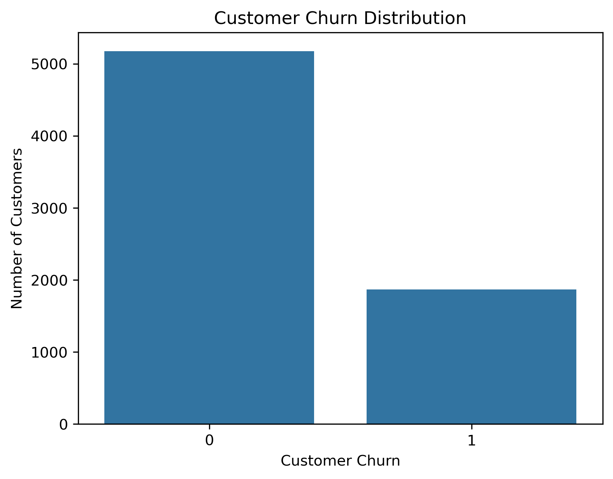
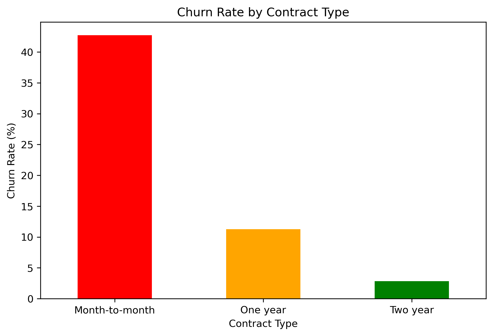
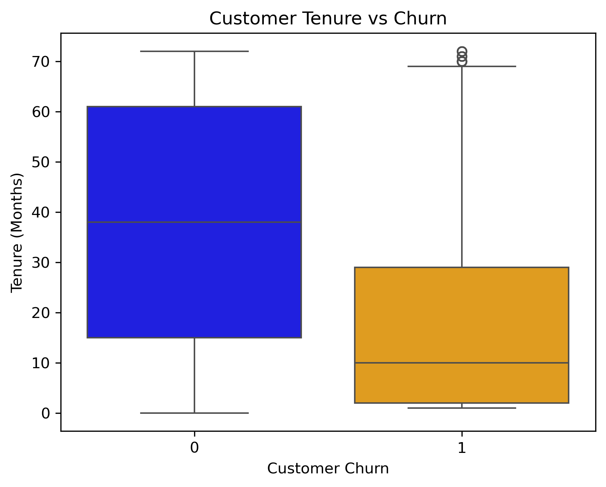
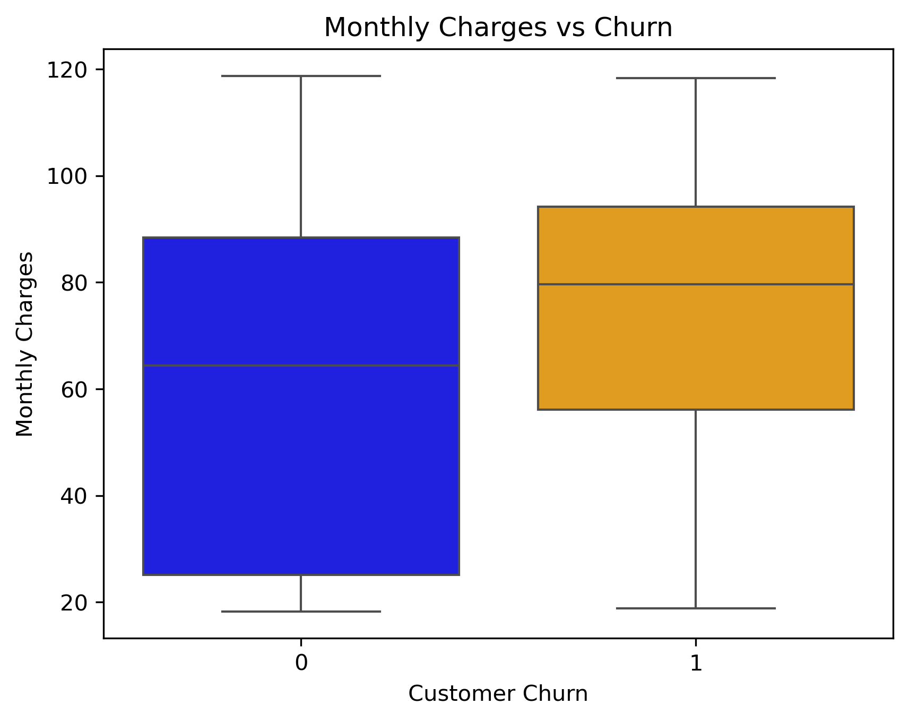

# Telco Customer Churn Prediction

## Project Overview
This project analyzes customer churn in the telecommunications industry using Python and machine learning. The objective is to identify customer characteristics and service patterns associated with churn and build classification models that can help businesses identify customers at risk of leaving.

## Objectives
- Analyze customer behavior and identify churn patterns.
- Explore relationships between customer tenure, contracts, services, charges, and churn.
- Build and compare multiple machine learning classification models.
- Evaluate model performance and explore classification threshold optimization.
- Translate analytical findings into actionable business recommendations.

## Dataset
The project uses the Telco Customer Churn dataset containing 7,043 customer records.

The dataset includes customer demographics, account information, subscribed services, contract details, monthly charges, total charges, and churn status.

## Tools & Technologies
- Python
- Pandas
- NumPy
- Matplotlib
- Seaborn
- Scikit-learn
- Jupyter Notebook

## Exploratory Data Analysis
The analysis revealed several patterns associated with customer churn:

- Customers in their first 12 months had a churn rate of approximately 47.44%.
- Month-to-month contracts showed substantially higher churn than longer-term contracts.
- Fiber optic customers had a churn rate of approximately 41.89%.
- Customers without Tech Support had a churn rate of approximately 41.64%.
- Customers paying through electronic checks had a churn rate of approximately 45.29%.
- Customers without Online Security had a churn rate of approximately 41.77%.

These findings were used to identify potential customer retention opportunities.

### Visual Analysis

#### Customer Churn Distribution

#### Churn by Contract Type

#### Churn vs Tenure

#### Churn vs Monthly Charges

## Machine Learning Models
The following classification models were developed and evaluated:

- Logistic Regression
- Decision Tree
- Random Forest

The models were evaluated using:
- Accuracy
- Precision
- Recall
- F1 Score
- Confusion Matrix
- ROC Curve
- ROC-AUC

Cross-validation was also performed to assess model consistency.

## Data Cleaning & Preprocessing

The dataset was inspected for missing values, data types, and inconsistencies before model training.

- **TotalCharges:** Converted from object/string to numeric format to enable mathematical analysis.
- **Missing Values:** The 11 missing values in `TotalCharges` were handled during preprocessing.
- **Categorical Encoding:** Categorical variables were encoded into numerical representations for machine learning.
- **Feature Scaling:** Numerical features were scaled where required, particularly for Logistic Regression.
- **Train-Test Split:** The data was divided into training and testing sets to evaluate model performance on unseen data.

Preprocessing was integrated into the machine learning workflow to ensure consistent transformations during model training and evaluation.

## Model Results

### Logistic Regression — Default Threshold (0.50)
- Accuracy: 79.91%
- Precision: 65.22%
- Recall: 52.14%
- F1 Score: 57.95%

### Logistic Regression — Adjusted Threshold (0.35)
- Accuracy: 77.57%
- Precision: 56.04%
- Recall: 71.93%
- F1 Score: 63.00%
- ROC-AUC: 0.8421

The threshold of 0.35 increased recall, allowing the model to identify more churn-risk customers, while reducing accuracy and precision.

## Model Performance Comparison

Three machine learning models were trained and evaluated on the customer churn dataset.

| Model | Accuracy | Precision | Recall | F1 Score |
|---|---:|---:|---:|---:|
| Logistic Regression | 79.91% | 65.22% | 52.14% | 57.95% |
| Decision Tree | 79.42% | 63.13% | 54.01% | 58.21% |
| Random Forest | 79.99% | 65.86% | 51.07% | 57.53% |

Logistic Regression was selected for further experimentation with classification thresholds to explore the trade-off between precision and recall, particularly for identifying customers likely to churn.

### Threshold Tuning

The default classification threshold of 0.50 was adjusted to 0.35 to increase the model's ability to identify customers likely to churn.

Lowering the threshold increased recall from 52.14% to 71.93%, allowing the model to identify more actual churners. However, this came at the cost of lower precision and accuracy, meaning more non-churning customers were incorrectly flagged as potential churners.

This experiment demonstrates the trade-off between precision and recall and highlights how classification thresholds can be adjusted based on business objectives.

**Note:** The threshold was explored using test-set results in this project. In a more rigorous workflow, threshold selection should be performed using validation data, with the final test set kept untouched for unbiased evaluation.

## Cross-Validation
Logistic Regression achieved a mean 5-fold cross-validation accuracy of approximately 80.48%, with a standard deviation of approximately 1.28%.

## Key Business Recommendations
- Improve onboarding and engagement during the first year of customer tenure.
- Encourage customers to consider longer-term contracts.
- Investigate pricing, service quality, and customer experience among fiber optic customers.
- Improve awareness and adoption of support and security services.
- Review the customer experience associated with electronic-check payments.
- Consider targeted retention campaigns for customers with higher churn risk.

## Conclusion
This project demonstrates an end-to-end data science workflow, including data cleaning, exploratory analysis, feature engineering, preprocessing, model training, evaluation, cross-validation, threshold analysis, and business recommendations.

It highlights how machine learning can support customer retention strategies by identifying patterns associated with churn.

## Future Improvements
- Hyperparameter tuning
- Testing additional classification algorithms
- Optimizing classification thresholds using validation data and business costs
- Building an interactive dashboard
- Deploying the model as a web application

## Author
Amrit Suman Mohapatra
